# 定制礼物需求文档

> 版本：2.1.40　｜　状态：评审稿；已确认规则已纳入正文，未决事项见第6节。
>
> 本文依据《定制礼物需求.xmind》、独立页面原型和全交互图编写。脑图用于定义业务规则，原型用于补充页面结构和交互；两者存在冲突时，统一列入待确认。业务建模稿中的推断内容不作为已确认需求。

## 1. 需求范围

### 1.1 业务目标

为满足定制权益条件的用户提供礼物名称、价格、封面和动效的配置能力；在礼物栏增加定制礼物分类，提供定制礼物排行榜入口、所选礼物榜一用户展示，以及按本月与上月有效充值金额中的最高值匹配边框样式。

### 1.2 模块与阅读索引

| 模块 | 页面/规则范围 | 正文位置 | 当前状态 |
|---|---|---|---|
| 定制礼物栏 | 分类、顶部Banner、所选礼物榜一头像、礼物排序与赠送入口 | 4.1 | 榜一、周排序和到期隐藏规则已确认；空态提示本次不处理 |
| 定制礼物排行榜 | Rank/Upload、本周/上周、榜单展示、刷新提示 | 4.2 | 排行主体与周期排序口径已确认；展示映射及边界规则部分待确认 |
| 未获得权益 | 权益卡、How to get、问号、获取方式 | 4.3 | 权益来源收敛为月度充值活动；发放失败及退款规则待确认 |
| 上传空状态 | 名称、价格、封面、动效、上传按钮、剩余天数 | 4.4 | 最低价及首次计次已确认；素材校验本次不处理 |
| 已填写未提交 | 内容展示、上传动作、提交结果边界 | 4.5 | 成功提交后立即展示可赠送；失败与幂等仍待确认 |
| 已填写本月已提交 | 内容修改、收费确认、价格锁定限制 | 4.6 | 字段独立免费次数及非价格付费修改已确认；价格每自然月只能设置或修改1次，月内不得二次改价 |
| 共用业务规则 | 权益、价格、修改额度、时间、统计、边框 | 2、5 | 已知规则与缺口分开记录 |
| 后台定制礼物管理 | 定制礼物列表、详情、筛选、导出、展示状态操作及增加各字段当月免费修改次数 | 5.7 | 无素材审核；成功操作后客户端立即生效；后台角色、权限及审计仍待确认 |

### 1.3 材料与范围边界

- 本次原型范围为 `2.1.40原型图` 中的六张独立页面图及一张全交互流程图。
- 本文只描述定制礼物相关能力。房间座位、玩法、其他礼物分类与系统状态栏不作为新增需求展开。
- 原型中的名称、价格、排名数值、头像及剩余23天均为示例，不作为默认业务配置。
- 同版本目录已有后台HTML及其完整页面导出图，本期以该原型定义后台页面结构、字段和可见交互；示例数据不等于正式配置。定制礼物无需素材审核，成功提交或成功修改后客户端立即生效；后台角色、权限、操作理由与审计规则仍待确认。
- 下文“待确认Uxx”对应第6节。它表示需求尚未明确，不是页面新增状态、系统报错或实际执行步骤。

## 2. 业务模型与统一口径

### 2.1 角色

| 角色 | 业务职责 | 权限边界 |
|---|---|---|
| 使用礼物面板的用户 | 查看定制礼物、选择打赏对象、发起赠送、查看榜单 | 上传权益仅用于配置定制礼物，不作为赠送资格 |
| 定制礼物权益用户 | 设置名称、价格、封面和动效，使用相应修改权益 | 权益获得方式、有效期和修改次数分别管理；获得权限不直接等于礼物已生效 |
| 打赏对象 | 接收用户赠送的定制礼物 | 收礼资产及收益换算规则未提供，见U09 |
| 后台管理人员 | 查看定制礼物列表与详情，并按已确认权限执行展示状态维护 | 后台人员的角色、数据范围及查看、查询、导出、下架、恢复权限见U07；页面入口不代表用户已获得对应操作权限 |

### 2.2 核心对象

| 对象 | 定义 | 与其他对象的关系 | 不可混用的概念 |
|---|---|---|---|
| 定制礼物权益 | 用户通过月度充值活动获得的配置资格，每次成功发放增加30天 | 同一用户每个UTC+3自然月最多成功获得1次；有效权益在原到期时间上顺延30天，无有效权益时从发放成功时间起算；次月达标形成新的权益发放记录，但沿用同一定制礼物业务身份 | 权益发放次数、权益有效天数和礼物数量不是同一个指标；单份权益可关联的定制礼物数量仍待确认 |
| 定制礼物 | 由名称、金币价格、封面及动效组成的礼物内容 | 成功提交后无需审核，立即在礼物栏展示并可赠送；修改处理中继续使用旧内容，修改成功后立即切换新内容 | 已填写未提交不等于可赠送；权益到期后礼物栏隐藏，但礼物信息、礼物身份及历史记录继续保留；后续新权益成功发放后自动恢复展示并可赠送 |
| 价格设置资格 | 每个自然月只有1次设置或修改礼物价格的机会，首次设置即占用当月次数 | 价格成功设置后当月锁定，月内不得二次改价；次月新价格成功生效后替换旧价格 | 改价机会不是金币余额，也不属于非价格信息的免费或付费修改机会；300000金币付费修改不得增加改价次数 |
| 内容修改权益 | 名称、封面、动效三个字段分别拥有每自然月1次免费机会；首次成功上传分别占用各字段当月免费次数 | 无实际变化不计次；任一实际变化字段的免费次数已用时，本次提交收取300000金币；付费修改次数不限；扣费和次数实际消耗时点见U06 | 价格不属于该付费修改范围；同一次提交无论包含一个或多个超额字段，合计只收取一次300000金币 |
| 礼物赠送金额 | 指定定制礼物发生赠送时对应的金币金额 | 为礼物栏排序和所选礼物榜一用户判断提供统计依据 | 礼物标价、赠送金额、修改费用分开表达 |
| 边框样式 | 按定制礼物所属用户统计本月与上月活动有效充值金额并取最高值，实时匹配定制礼物外观 | 低于US$2,000显示基础默认样式；达到US$2,000显示普通档位；达到US$3,000显示高级档位；月切时重新匹配 | 边框档位不直接代表上传权益来源或修改次数；全部存量礼物同步使用当前匹配结果 |

| 后台增加各字段免费修改次数 | 后台输入N后，名称、封面、动效三个字段的当月免费修改次数分别增加N次 | 各字段独立记录、独立消耗；仅增加当月次数，未用完不结转下月；不增加价格修改机会、不延长权益有效期 | 不设置共用修改次数池；修改多个字段时，每个实际变化字段分别消耗自身1次，见5.3.2 |

### 2.3 三种统计展示分别定义

| 展示 | 排序/判断对象 | 已明确口径 | 尚未明确部分 |
|---|---|---|---|
| 定制礼物栏排序 | 不同定制礼物 | 仅按各定制礼物的本周榜单积分降序排列，不使用上传者本月充值金额、首次上传时间或先达到积分时间参与排序 | 本周榜单积分按UTC+3自然周实时统计；同积分时不定义额外业务优先级 |
| 所选礼物榜一用户头像 | 向同一个定制礼物贡献赠送金币的不同用户 | 选择某个定制礼物后，展示UTC+3自然周内赠送该礼物金币数量最高且最先达到该金额的用户头像 | 无贡献及身份失效时的占位表现本次不处理；同时达到同额的最终稳定排序仍待确认 |
| Rank页面 | 不同定制礼物 | 本周榜仅按各定制礼物的本周榜单积分降序排列，不使用上传者本月充值金额、首次上传时间或先达到积分时间参与排序；上周榜直接展示周结束时冻结的排名与积分 | 大图、名称与右侧数值分别承接礼物封面、礼物名称和对应周期榜单积分；小圆图与其名称展示对应周期内赠送该礼物金币金额最高且最先达到该金额的榜一用户；退款/撤销处理沿用普通礼物规则 |

### 2.4 状态分层

| 层级 | 状态/阶段 | 进入依据 | 页面及后续影响 |
|---|---|---|---|
| 权益 | 未获得 | 用户尚未获得定制礼物权益 | 展示4.3，不以空白上传表单代替权益引导 |
| 权益 | 有效期内 | 每次成功发放增加30天；当前仍有效时从原到期时间顺延，无有效权益时从发放成功时间起算 | 可承接上传配置；每个UTC+3自然月最多成功获得1次 |
| 权益 | 到期 | 有效期限结束 | 礼物从定制礼物栏隐藏，Upload入口进入未获得权益状态；礼物身份和历史记录继续保留，次月达标后形成新权益发放记录 |
| 表单 | 空状态 | 原型展示名称、价格为空，封面及动效待选择 | 展示4.4 |
| 表单 | 已填写未提交 | 名称、价格及素材均已填入当前表单 | 展示4.5，不代表礼物已经可赠送 |
| 表单 | 已填写本月已提交 | 当前礼物已有本月提交内容 | 展示4.6；允许修改的字段与次数见5.3 |
| 价格 | 已设置后的月内限制 | 每个自然月只能设置或修改1次；价格成功设置后当月锁定，任何月内二次改价均不允许提交 | 锁定及次数实际落账时点仍见U06 |
| 礼物可用性 | 成功提交后生效 | 无需审核，成功提交后立即在礼物栏展示并可赠送；修改期间使用旧内容，修改成功后客户端立即切换 | “成功提交”的事务完成点、失败恢复和重复提交仍见U06 |

## 3. 业务流程

### 3.1 全交互原型

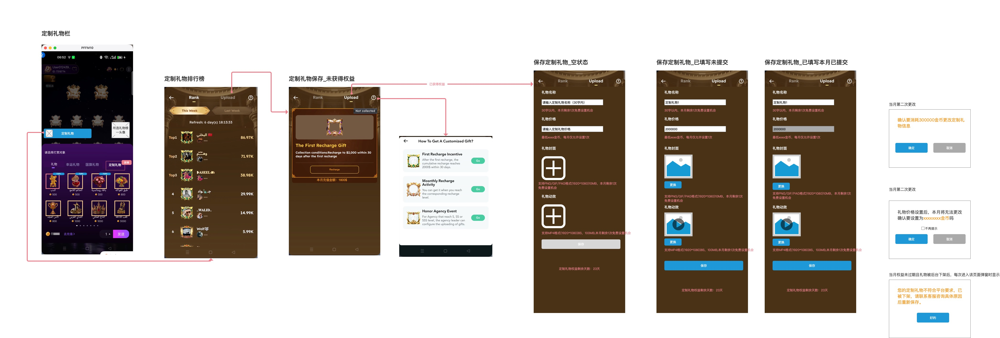

全图用于说明页面入口及页面关系；字段、规格和弹窗规则见第4节对应页面。全图及独立原型未明确的状态跳转统一列入待确认。

### 3.2 主流程

实线表示已确认路径，虚线表示待确认衔接；虚线路径不代表实际页面提示或已确认结果。

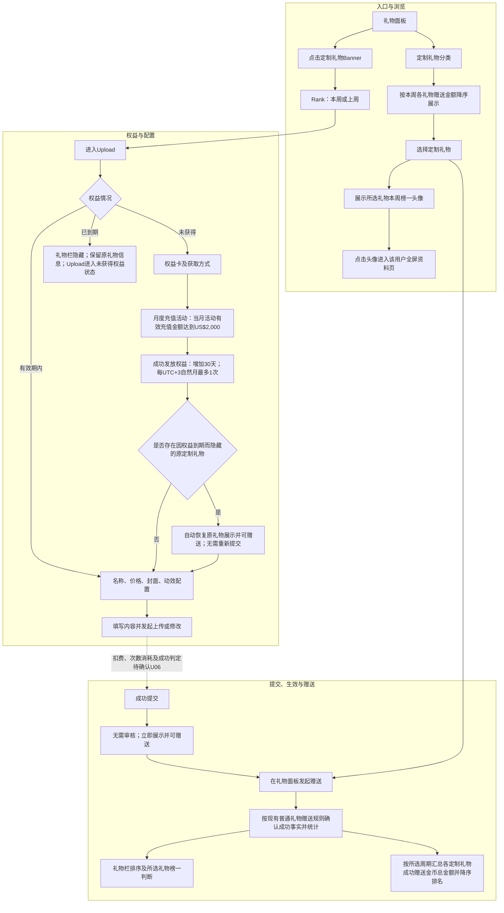

### 3.3 提交与修改的边界流程

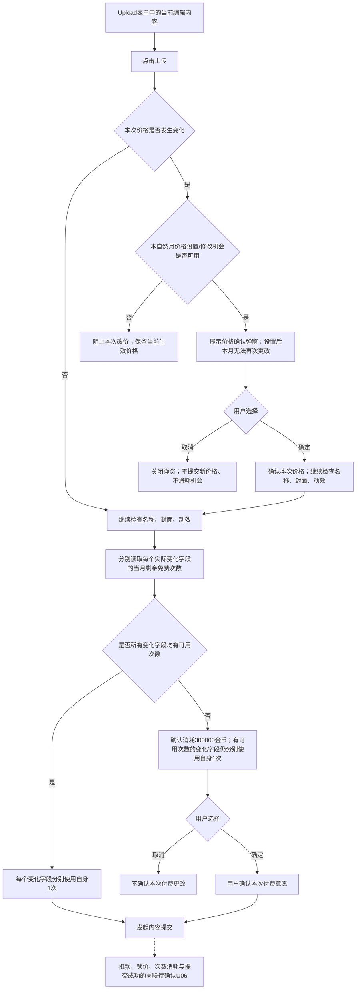

价格与非价格信息分别判断：每个自然月提供1次价格设置或修改机会；用户当月尚未使用该机会且本次价格发生变化时，先展示价格确认弹窗，明确“设置后本月将无法再次更改”。用户确认后才提交新价格，价格成功生效后消耗当月机会并锁定；取消不提交新价格、不消耗机会。当月机会已经成功使用后，再次改变价格才直接阻止。300000金币付费确认仅适用于名称、封面、动效，不增加价格修改机会。扣款、次数消耗、价格锁定和礼物生效分别以对应业务结果为准。

**后台增加次数衔接：** 后台输入N后，名称、封面、动效三个字段的当月免费修改次数分别增加N次，不设置三个字段共用的次数池。提交时，每个实际变化字段独立判断并消耗自身1次；只要任一变化字段无可用次数，本次提交进入300000金币付费路径，有可用次数的其他变化字段仍分别使用自身次数。同一次提交包含一个或多个无可用次数字段时，合计只收取一次300000金币。具体规则见5.3.2。

## 4. 客户端功能需求

### 4.1 定制礼物栏

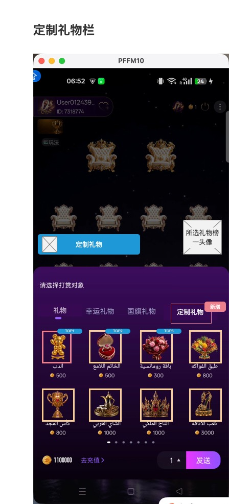

#### 4.1.1 页面定位与前置条件

在房间礼物面板中增加“定制礼物”分类。顶部定制礼物Banner承接排行榜入口，所选礼物榜一头像承接该用户全屏资料页入口。

“新增”红色标注仅用于说明版本变化，客户端不展示该常驻角标。Banner与榜一头像为独立点击区域：Banner进入排行榜，榜一头像进入对应用户的全屏资料页。

#### 4.1.2 页面字段

| 区域/字段 | 展示与操作 | 数据来源/统计方式 |
|---|---|---|
| 定制礼物Tab | 在礼物分类中增加“定制礼物”，用于展示本类礼物 | 当前定制礼物集合；默认选中分类未定义 |
| 定制礼物Banner | 位于礼物面板上方，点击进入定制礼物排行榜 | 固定入口；是否依赖已选礼物见U01 |
| 所选礼物榜一头像 | 位于礼物面板上方右侧，显示当前选择礼物的本周榜一用户 | 按UTC+3自然周比较各用户本周赠送金币累计量；同额时先达到该金额者为榜一 |
| 礼物图与名称 | 礼物网格展示对应礼物内容 | 定制礼物的可展示名称及封面；生效条件见U07 |
| 礼物金币价格 | 每个礼物展示对应金币价格 | 该礼物当前有效价格；不使用原型示例价作为统一价格 |
| 礼物边框 | 展示定制礼物所属用户当前匹配的边框样式 | 5.6；按本月与上月活动有效充值金额最高值匹配：低于US$2,000为基础默认样式，达到US$2,000为普通档，达到US$3,000为高级档 |
| 打赏对象 | 原型展示“请选择打赏对象” | 当前房间赠送对象；多选、自送等范围见U09 |
| 金币余额/去充值 | 显示余额并提供充值入口 | 用户当前金币余额；充值落点不在材料中展开 |
| 数量/发送 | 选择数量后发起定制礼物赠送 | 原型数量示例为1；可选档位和发送规则见U09 |

#### 4.1.3 交互逻辑

**入口与切换**

1. 用户打开礼物面板，可见定制礼物分类入口。
2. 切换至定制礼物分类后，仅按各定制礼物在UTC+3当前自然周的本周榜单积分降序排列；不追加上传者本月充值金额、首次上传时间或先达到积分时间等排序条件。
3. 点击定制礼物Banner进入4.2。该入口与所选礼物榜一头像的点击行为独立。

**选择与查看**

1. 选择某个定制礼物，榜一头像关联到该礼物，不沿用其他礼物的榜一信息。
2. 用户点击榜一头像后，进入该榜一用户的全屏资料页。
3. 榜一金额同额时，先达到该金额的用户优先；未选择礼物、无人赠送及身份失效时的头像占位表现本次不处理。

**赠送**

用户通过打赏对象、数量和发送按钮发起赠送。定制礼物赠送沿用系统现有普通礼物规则，包括赠送对象、数量、资格、扣费、收礼结果、失败、退款和撤销。上传权益不影响普通用户的赠送资格；本期不新增赠送奖励。

#### 4.1.4 状态与异常

| 场景 | 处理口径 |
|---|---|
| 有礼物列表 | 按本周礼物金额降序展示 |
| 用户更换所选礼物 | 所展示榜一用户对应新选择的礼物 |
| 没有可展示的定制礼物 | 空态样式、Banner和头像是否保留见U12 |
| 所选礼物在赠送前失效 | 发送是否拦截、如何提示以及列表更新见U07、U09 |
| 周切换/同积分/无人赠送 | 使用UTC+3自然周；礼物栏仅按本周榜单积分降序排列，同积分时不定义额外业务优先级；占位及Refresh表现本次不处理 |

### 4.2 定制礼物排行榜

#### 4.2.1 页面定位与前置条件

承接定制礼物Banner入口，提供Rank与Upload两类功能。当前原型展示Rank页，支持本周和上周两个时间选项。

**排行主体与排序口径：** Rank页面以“定制礼物”为排行主体，不按礼物拥有者或送礼用户排行。本周榜仅按各定制礼物的本周榜单积分降序排列，不使用上传者本月充值金额、首次上传时间或先达到积分时间参与排序；同积分时不定义额外业务优先级。上周榜直接展示上一UTC+3自然周结束时冻结的排名与积分。本周与上周独立统计，上周榜不使用本周实时数据计算。失败、取消或未实际扣款的赠送不计入；退款、撤销及冲正后的扣减与重排规则见U08、U09。

#### 4.2.2 页面字段

| 字段/控件 | 展示及交互 | 数据来源/统计方式 |
|---|---|---|
| 返回 | 页面左上角返回入口 | 返回目标与是否恢复房间礼物面板见U12 |
| Rank | 排行榜功能标签，当前原型选中 | 当前榜单页 |
| Upload | 点击进入定制礼物上传相关页面 | 按权益情况分流，不直接固定跳空表单 |
| 问号 | 页面帮助入口 | 未获得权益页同类问号有明确获取方式连线；此页是否共用见U12 |
| This Week | 展示本周榜单，原型中高亮 | 按UTC+3自然周实时统计当前周 |
| Last Week | 展示上周榜单 | 上周自然周结束后冻结排名与金额；历史图文展示当前内容还是周期图文仍待确认 |
| Refresh | 原型显示剩余天数及时间 | 示例“6 day(s) 18:13:33”；倒计时对应周期结束还是其他刷新机制见U08 |
| 排名 | 前列为Top1、Top2、Top3，后续使用数字 | 本周仅按本周榜单积分降序；不追加本月充值金额、上传时间或先达到积分时间等排序条件；上周读取周结束时冻结排名；不将截图可见行数当展示上限 |
| 大图及边框 | 每行主要图形 | 对应当前排名定制礼物的封面及边框；历史周期读取当前内容还是周期快照见U08 |
| 名称 | 主要图形右侧名称 | 对应当前排名定制礼物的礼物名称；历史周期读取当前名称还是周期快照见U08 |
| 小圆图与名称 | 礼物名称下方的附属信息 | 展示所选周期内赠送该礼物金币金额最高且最先达到该金额的榜一用户头像和名称 |
| 右侧数值 | 示例86.97K等 | 对应定制礼物在所选周期内被成功赠送的金币总金额；单位缩写与展示精度见U08 |

#### 4.2.3 交互逻辑

1. 从Banner进入Rank页，原型展示本周选项为选中状态；是否每次重进都重置本周，见U12。
2. 切换This Week/Last Week时，分别读取本周榜或上周榜：本周榜按UTC+3当前自然周实时统计，并仅按本周榜单积分降序排列；不追加其他排序条件。上周榜直接读取上一自然周结束时冻结的排名与积分；两个周期独立计算。
3. 点击Upload：未获得权益或权益已到期均进入4.3；有有效权益时承接4.4—4.6对应内容状态。
4. 本期榜单行不支持点击跳转，不提供资料页、礼物详情或赠送入口。
5. 本期不提供本人固定排名、奖励领取及榜单奖励功能。

#### 4.2.4 状态与异常

| 场景 | 处理口径 |
|---|---|
| 本周有数据 | 仅按本周榜单积分降序排列；同积分时不再按上传者本月充值金额、首次上传时间或先达到积分时间排序 |
| 上周有数据 | 展示上一自然周结束时冻结的排名与金额，不按当前充值金额重新排序，不能混用本周记录、本周数值和上周标识 |
| 刷新倒计时结束 | 周期切换、重新取数及空态落点见U08 |
| 上周无数据/读取失败 | 展示、重试入口及提示见U12 |
| 礼物内容被修改或权益到期 | 延续同一礼物身份及历史记录，不删除历史贡献；上周榜金额和排名保持冻结，榜单图文展示当前内容还是周期图文仍待确认 |

### 4.3 定制礼物上传——未获得权益

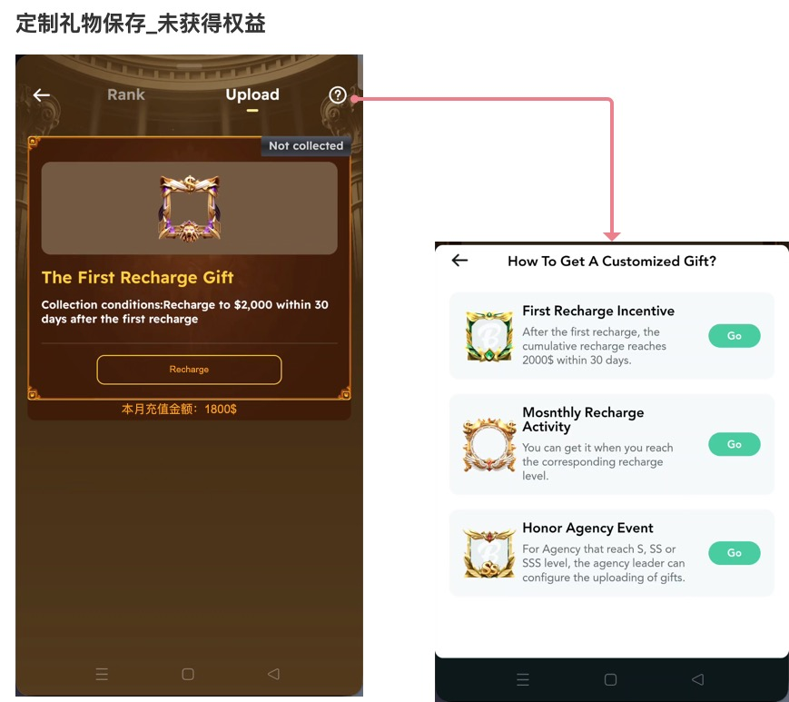

#### 4.3.1 页面定位与前置条件

用户从未获得权益，或曾有权益但权益已到期时，Upload统一进入未获得权益状态。当前版本的权益来源仅保留**月度充值活动**；原型中的首次充值激励和荣誉公会活动不再作为本期权益来源。

#### 4.3.2 页面字段

| 区域/字段 | 展示内容 | 业务含义/数据来源 |
|---|---|---|
| Rank/Upload | Upload选中 | 可在榜单和上传功能间切换 |
| 返回/问号 | 顶部入口 | 问号进入获取方式说明；返回状态恢复本次不处理 |
| 权益示意图 | 金色权益卡内的示意图 | 展示定制礼物权益，不解释为用户已经上传的礼物封面 |
| Not collected | 未获得权益状态文案 | 用户当前无有效定制礼物权益；不新增手动领取按钮 |
| 月度充值活动 | 当前唯一权益来源 | 当月活动有效充值金额达到US$2,000后，触发一次权益发放 |
| How to get? | 获取方式入口 | 进入月度充值活动获取说明；具体跳转目标本次不处理 |

#### 4.3.3 获取与发放规则

1. 月度累计和活动有效充值金额完全沿用充值活动PRD口径，按UTC+3自然月统计。
2. 同一用户当月活动有效充值金额达到 `US$2,000` 后，成功发放一次定制礼物权益并增加30天有效期。
3. 同一用户每个UTC+3自然月最多成功发放1次；重复达标不得重复增加天数。
4. 用户当前无有效权益或权益已到期时，从本次发放成功时间起计算30天。
5. 用户当前权益仍有效时，从原到期时间继续顺延30天。
6. 次月再次达标时形成新的权益发放记录，不复用上月发放记录；礼物业务身份和历史记录继续沿用。
7. 用户点击Go或充值金额达到门槛后，权益不会立即视为到账；权益状态以发放成功结果为准。发放失败、重试、补发幂等以及退款、撤销、冲正后的权益处理仍待确认。

#### 4.3.4 页面与状态衔接

1. 无有效权益时不开放礼物信息提交。
2. 权益成功发放后，页面切换至对应上传/修改状态，并展示新的权益到期时间或剩余天数。
3. 权益到期后，用户的定制礼物从礼物栏隐藏，Upload回到本节未获得权益状态；原礼物信息、礼物身份及历史记录继续保留。
4. 后续重新获得的是新的权益发放记录，并继续关联原定制礼物；因权益到期而隐藏的原礼物在权益成功发放后自动恢复至礼物栏展示并可赠送，无需用户重新上传或提交，不创建第二个礼物。

#### 4.3.5 状态与异常

| 场景 | 处理口径 |
|---|---|
| 当月未达US$2,000 | 保持未获得权益引导 |
| 达标但权益尚未成功发放 | 不提前增加30天；发放延迟、重试、补发及提示仍待确认 |
| 当月重复达到或超过门槛 | 当月已成功发放过时不重复增加天数 |
| 曾有权益但已到期 | 礼物栏隐藏定制礼物，Upload展示未获得权益状态；原礼物信息、礼物身份和历史记录保留；后续新权益成功发放后自动恢复展示并可赠送 |
| 退款、撤销或冲正 | 是否追回权益、扣减天数或恢复当月发放资格，继续待确认 |

### 4.4 上传定制礼物——空状态

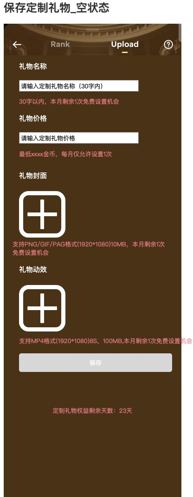

#### 4.4.1 页面定位与前置条件

该页面适用于用户已获得权益且当前表单为空的场景，用于输入礼物名称、价格并选择封面、动效。当前礼物已有本月提交内容且满足该页进入条件时，对应4.6；仅有历史提交或权益到期后的入口见U02、U03。用户再次进入Upload时，继续关联原定制礼物，不自动创建新礼物。

#### 4.4.2 页面字段与输入规则

| 字段/控件 | 展示、输入或提示 | 来源与规则 |
|---|---|---|
| Rank/Upload、返回、问号 | Upload选中，顶部展示导航入口 | 跨页返回及问号落点见U12 |
| 礼物名称 | “请输入定制礼物名称（30字内）”；字段下方展示“30字以内，本月剩余{名称次数}次免费修改” | 用户填写；名称剩余次数由服务端按名称字段独立返回，字符计数及名称合法性见U11 |
| 礼物价格 | “请输入定制礼物价格” | 用户填写金币价格；最低价格暂定200000金币，可设置更高价格，最高价及输入格式仍待确认 |
| 价格说明 | “最低200000金币，每月仅允许设置1次” | 最低价格为暂定值；价格不展示免费修改次数；首次设置占用当月1次，成功设置后在该自然月内锁定 |
| 礼物封面 | ＋号素材选择区；字段下方展示格式、分辨率、服务端返回的体积上限及“本月剩余{封面次数}次免费修改” | PNG/GIF/PAG；封面图片体积上限由服务端配置，默认1MB；客户端不得写死 |
| 礼物动效 | ＋号素材选择区；字段下方展示格式、分辨率、时长、服务端返回的体积上限及“本月剩余{动效次数}次免费修改” | MP4；动效文件体积上限由服务端配置，默认10MB；客户端不得写死；分辨率和时长执行含义见U11 |
| 上传 | 空表单中呈灰色 | 原型对比填完后呈蓝色；可点击条件及校验顺序见U11 |
| 定制礼物权益剩余天数 | “定制礼物权益剩余天数：23天” | 当前权益剩余时长的天数展示；23天为示例，取整及到期边界见U03 |

**素材规格边界：** 原型中的封面10MB、动效100MB以及空状态封面8S/100MB均不作为正式体积限制。正式规则为：封面图片体积上限由服务端配置，默认1MB；礼物动效文件体积上限由服务端配置，默认10MB。客户端展示和校验均使用服务端当前配置，不得写死默认值。1920×1080与动效8S属于固定值、推荐值还是上限仍见U11；不得把动效时长8S套用于静态封面。

重点：上传表单的数值部分不得由客户端写死，必须由服务端返回。封面图片体积上限默认1MB，礼物动效文件体积上限默认10MB，两个默认值属于服务端配置默认值，不是客户端本地常量；客户端必须使用服务端返回的当前配置进行文案展示与文件校验。其他数值还包括名称字数限制、最低礼物价格、每月设置/修改次数、素材分辨率/时长限制、名称/封面/动效剩余免费修改次数、权益剩余天数及已有礼物价格。客户端必须在名称、封面、动效各自字段下展示对应字段的剩余次数，不得相加、取最小值或继续使用一个统一次数代替三个字段值。

#### 4.4.3 交互逻辑

1. 用户分别输入名称、金币价格，并通过封面、动效选择区添加素材。
2. 当前表单有输入及素材后，承接4.5的已填写未提交展示。
3. 名称、价格和素材约束按5.2、5.3、5.5定义；超长名称、最低价以下输入、错误格式等提示与拦截时点见U11。
4. 页面展示权益剩余天数；进入此页不重新开始计算权益有效期。
5. 用户离开、返回、选择素材取消后的草稿保留策略见U12，不新增草稿箱功能。

名称、封面、动效各自字段下展示服务端返回的本字段本月剩余免费修改次数；上传按钮下方仅展示权益剩余天数，不再展示统一的“本月剩余免费修改次数”。进入页面时下架弹窗判断见4.4.5。

#### 4.4.4 状态与异常

| 场景 | 页面/业务处理 |
|---|---|
| 全部为空 | 按空状态原型显示输入占位和素材＋号，上传按钮灰色 |
| 部分已填写 | 保留当前已填字段的展示；按钮状态与具体校验见U11 |
| 全部示例内容已填写 | 展示4.5，不代表已提交或已生效 |
| 素材选择失败/格式不符 | 提示、素材保留及重选行为见U11 |
| 编辑期间权益到期 | 礼物栏隐藏且Upload回到未获得权益状态；当前未提交草稿是否保留、已打开页面能否继续提交仍待确认 |

#### 4.4.5 上传页面进入时的下架提示

进入Upload上传页面时，同时满足“用户定制礼物权益未过期”和“该定制礼物被后台下架”两个条件，显示定制礼物被下架提示弹窗。每次进入页面均判断并展示，不新增“不再提示”选项；该判断同样适用于4.5、4.6的上传表单状态，不只限于空表单。

| 弹窗内容/条件 | 规则 |
|---|---|
| 正文 | 您的定制礼物不符合平台要求，已被下架。请联系客服咨询具体原因后重新上传。 |
| 按钮 | 好的 |
| 权益未过期且被后台下架 | 每次进入上传页面显示上述弹窗 |
| 权益已到期 | 进入4.3未获得权益状态；不因历史下架状态命中本弹窗 |
| 权益未过期且未被后台下架 | 不显示本下架提示弹窗 |

权益到期隐藏与后台下架是不同原因，不能只根据“礼物未展示”判断是否弹窗。弹窗提示不代表自动恢复礼物展示，也不增加修改次数或改价机会；重新上传后的后台下架标记及恢复关系仍待确认，不从“重新上传”文案推导自动恢复规则。

### 4.5 上传定制礼物——已填写未提交

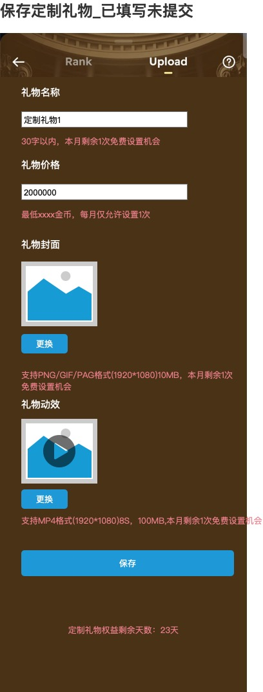

#### 4.5.1 页面定位与前置条件

用户已经在当前表单填写名称、价格，并选择封面和动效，但尚未提交。此状态用于检查当前填写内容和发起上传，不表示已创建可赠送礼物。

进入页面时同样执行4.4.5的权益有效且后台下架提示判断。

#### 4.5.2 页面字段

| 字段/控件 | 当前展示 | 数据来源/处理口径 |
|---|---|---|
| 礼物名称 | 示例“定制礼物1”；字段下方展示“30字以内，本月剩余{名称次数}次免费修改” | 当前输入内容；名称次数按字段独立返回；沿用30字内限制 |
| 礼物价格 | 示例2000000 | 当前填写的金币价格；不是最低价格或默认价格；不纳入免费修改次数体系 |
| 封面缩略图及更换 | 展示当前已选择的图片素材；点击图片可查看；下方展示“更换”按钮及“本月剩余{封面次数}次免费修改” | 点击“更换”拉起图片选择器；用户选择新图片后替换当前表单封面预览，尚未提交前不影响已生效内容 |
| 动效缩略图/播放标识及更换 | 展示当前已选择的MP4素材及播放标识；点击素材可播放；下方展示“更换”按钮及“本月剩余{动效次数}次免费修改” | 点击“更换”拉起视频选择器；用户选择新MP4后替换当前表单动效预览，尚未提交前不影响已生效内容 |
| 价格与素材说明 | 保留最低价、各字段次数和规格说明 | 与4.4相同；封面和动效体积上限分别使用服务端当前配置，默认1MB、10MB，不因填完而取消 |
| 上传 | 蓝色按钮 | 发起当前表单提交；最终校验条件见U11 |
| 权益剩余天数 | 示例23天 | 当前权益剩余天数，见U03 |

名称、封面、动效字段下的独立次数展示及全部数值来源沿用4.4.2；上传按钮下方不再保留统一次数。示例价格、各字段次数和天数均不得固化为客户端常量。

#### 4.5.3 交互逻辑

**提交前**

1. 页面展示当前填写内容，用户可检查名称、价格和素材。
2. 首次创建流程不展示4.6中的价格二次变化弹窗，也不新增首次创建确认弹窗。
3. 点击已选择的封面图片可查看图片；点击已选择的MP4素材可播放视频。查看或播放本身不形成字段变化，不消耗修改次数，也不触发上传或收费。
4. 封面与动效素材下方分别展示“更换”按钮：点击封面“更换”拉起图片选择器，点击动效“更换”拉起视频选择器；用户选择新素材后更新当前表单预览。选择器取消、查看方式、播放控件及预览失败处理见U11。

**发起上传与结果**

1. 点击上传发起当前内容提交。
2. 首次成功上传分别占用名称、封面和动效三个字段各自当月的1次免费机会；价格首次设置占用当月价格设置次数。实际扣款、次数消耗及提交成功的事务顺序仍见U06。
3. 提交成功后无需审核，礼物立即在定制礼物栏展示并可赠送，同时承接“已填写本月已提交”状态。返回、提示或留在原页的表现本次不处理。
4. 只有提交成功才切换可赠送内容；提交处理中继续使用旧内容，首次创建尚无旧内容时不得提前展示未成功内容。

#### 4.5.4 状态与异常

| 场景 | 当前需求边界 |
|---|---|
| 用户未点上传 | 内容仍是当前表单填写结果，不作为礼物生效依据 |
| 点击素材查看/播放 | 仅查看当前图片或播放当前MP4，不形成素材变化，不计次、不收费 |
| 点击更换后取消选择 | 保留当前表单素材，不形成字段变化，不计次、不收费 |
| 选择新的图片或MP4 | 更新当前表单对应素材预览；只有后续提交成功后才切换生效内容，计次与失败恢复见U06 |
| 提交成功 | 无需审核，立即形成当前有效内容并在礼物栏展示可赠送；锁价、扣费和次数消耗的事务先后仍见U06 |
| 提交失败/超时 | 是否保留素材、是否重试、费用和次数是否恢复见U06、U11 |
| 用户连续点击上传 | 重复操作识别与是否只生成一次业务结果见U06 |
| 提交时权益失效或跨月 | 使用哪个权益及次数周期见U03、U08 |

### 4.6 上传定制礼物——已填写本月已提交

**后台增加次数适用边界：** 后台输入N后，名称、封面、动效三个字段的当月免费修改次数分别增加N次，各字段独立使用，不设置共用次数。本节第二次及以后付费说明按每个实际变化字段的剩余次数分别判断；无实际变化不计次的规则保持不变。

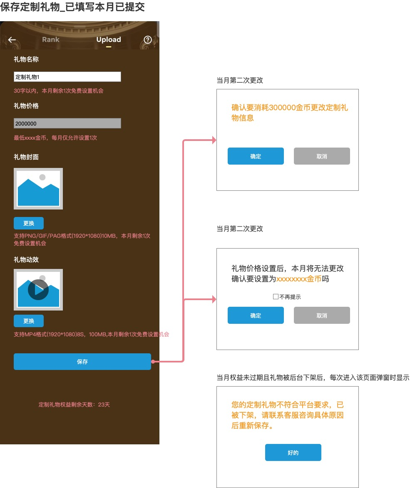

#### 4.6.1 页面定位与前置条件

用户当前礼物已有提交内容。页面用于查看现有内容，并在当前自然月价格修改机会可用时修改价格。页面同时保留非价格信息付费修改弹窗和价格修改确认弹窗，两者按实际变化字段分别触发。

价格框根据当月机会状态处理：当月尚未成功设置或修改价格时允许编辑；用户提交变化后的价格时，先通过4.6.4确认本次价格。新价格成功生效后，当月价格框进入锁定状态；当月再次改价直接阻止。非价格信息的付费修改不得增加或绕过价格修改机会。

进入页面时同样执行4.4.5的权益有效且后台下架提示判断。

#### 4.6.2 页面字段与操作

| 字段/控件 | 当前展示 | 本状态特有规则 |
|---|---|---|
| 礼物名称 | 示例“定制礼物1”；字段下方展示“30字以内，本月剩余{名称次数}次免费修改” | 名称次数由服务端独立返回；首次成功上传已占用名称当月免费次数 |
| 礼物价格 | 示例2000000；原型中的灰色输入区表示当月机会已使用后的锁定状态 | 当月价格机会未使用时允许编辑；提交变化价格时先展示价格确认弹窗；新价格成功后消耗当月1次机会并锁定；不展示免费修改次数 |
| 礼物封面 | 当前图片缩略图可点击查看；素材下方展示“更换”按钮及“本月剩余{封面次数}次免费修改” | 点击“更换”拉起图片选择器；选择新图片后更新表单封面预览；首次成功上传已占用封面当月免费次数 |
| 礼物动效 | 当前MP4缩略图及播放标识可点击播放；素材下方展示“更换”按钮及“本月剩余{动效次数}次免费修改” | 点击“更换”拉起视频选择器；选择新MP4后更新表单动效预览；首次成功上传已占用动效当月免费次数 |
| 上传 | 蓝色提交按钮 | 本状态下承接信息更改动作，不另外增加“保存”“编辑”按钮 |
| 权益剩余天数 | 示例23天 | 修改与续期对有效期的影响见U03 |

名称、封面、动效字段下的独立次数展示及全部数值来源沿用4.4.2；上传按钮下方不再展示统一次数。已提交原型仍缺少名称字段次数并保留统一次数，属于原型未同步项，不改变本节已确认的字段独立展示规则。

**素材查看与更换：** 点击当前封面图片查看图片；点击当前MP4动效播放视频。查看或播放不形成字段变化，不计次、不收费。点击封面下方“更换”拉起图片选择器，点击动效下方“更换”拉起视频选择器；选择新素材后仅更新当前表单预览并将对应字段标记为已变化，提交成功后才替换生效素材。取消选择器时保留原素材，不形成字段变化。

#### 4.6.3 当月第二次更改定制礼物信息确认

**触发条件：** 用户在当月再次修改名称、封面或动效，且任一实际变化字段的免费次数已用。

| 元素 | 原型文案/含义 |
|---|---|
| 提示内容 | 确认要消耗300000金币更改定制礼物信息 |
| 确定 | 确认本次付费更改意愿；不代表已扣款成功或内容已生效 |
| 取消 | 不确认本次付费更改；弹窗关闭及表单保留方式见U12 |

- 300000金币是本情形的更改费用，不是礼物价格。
- 名称、封面、动效分别计次；首次成功上传分别占用各字段当月第1次免费机会。
- 任一实际变化字段当月免费次数已用时，本次提交进入付费修改；当月第二次以及第三次及以后每次付费修改均收取300000金币。非价格信息付费修改次数不设上限；同一次提交包含多个超额字段时合计只收取一次300000金币。
- 余额不足、扣款失败、扣款后提交失败、重复确认的处理见U06，不以自动退款或额度自动恢复作为已确认规则。

#### 4.6.4 每月价格修改确认弹窗

当用户在新的自然月拥有1次价格修改机会，并将当前价格修改为新价格后，点击上传时展示本弹窗。弹窗用于提醒用户：本次新价格成功后，本自然月将不能再次修改；不是因为礼物已有历史价格就禁止本月首次改价。

| 元素 | 原型文案/含义 |
|---|---|
| 触发条件 | 当前自然月价格修改机会未使用，且本次输入价格与当前生效价格不同 |
| 限制提示 | 礼物价格设置后，本月将无法更改 |
| 价格确认 | “确认要设置为{本次输入价格}金币吗”；金额使用用户本次输入值 |
| 不再提示 | 原型包含该选项；生效范围与保存周期仍见U12，不影响每自然月仅1次价格修改机会 |
| 确定 | 确认本次新价格并继续提交；仅在新价格成功生效后消耗当月机会并进入锁定，具体事务时点见U06 |
| 取消 | 关闭弹窗，不提交新价格、不消耗当月价格修改机会；表单是否保留本次输入见U12 |
| 当月机会已使用 | 不再展示可确认继续改价的弹窗，直接阻止价格变化并继续使用当前生效价格 |

**价格设置规则：** 每个自然月允许成功设置或修改1次价格。首次创建时设置价格占用创建当月机会；进入后续自然月后，在权益有效且当月价格机会未使用时，用户可以修改1次价格。提交变化后的价格时先展示本节确认弹窗；新价格成功生效后当月锁定，再次改价直接禁止。

#### 4.6.5 交互顺序与状态

1. 用户对已有内容发起修改，点击上传。
2. 系统先判断价格是否变化及本自然月价格机会是否可用：未变化则继续；已变化且机会可用时展示4.6.4确认弹窗；已变化但机会已使用时直接阻止本次改价。
3. 用户确认新价格后继续本次提交；用户取消时不提交新价格、不消耗机会。新价格成功生效后才消耗当月价格机会并锁定，具体事务时点与失败恢复见U06。
4. 非价格信息按字段分别判断免费次数；字段免费次数已用时进入300000金币付费修改确认。价格修改不纳入300000金币付费路径。
5. 同次提交同时包含价格与非价格变化时，两类条件分别判断；弹窗同时命中时的先后顺序及取消其中一个后是否继续另一部分提交见U06、U12。
6. 修改提交处理期间继续使用旧内容；修改成功后客户端立即切换新内容。礼物身份和历史记录继续沿用，上周榜金额与排名不因修改而重算；历史榜图文显示当前还是周期内容仍待确认。

#### 4.6.6 异常与边界

| 场景 | 待明确处理 |
|---|---|
| 同时修改名称、封面、动效 | 分别判断各字段免费次数；只要任一实际变化字段的免费次数已用，本次提交合计收取一次300000金币，不按超额字段数量叠加 |
| 封面免费次数已用，动效未用 | 封面命中付费条件，动效使用自身免费机会；本次合并提交收取一次300000金币 |
| 没有实际变化仍点上传 | 不计修改次数、不产生修改费用；提交反馈本次不处理 |
| 修改费用余额不足 | 是否拦截、提示及充值后是否继续原操作，见U06 |
| 同一修改重复点击/结果未返回 | 是否合并结果、如何避免重复扣款和消耗次数，见U06 |
| 同时改价格与非价格信息 | 价格机会可用时分别进入价格确认与非价格次数/收费判断；两个弹窗同时命中的顺序、取消其中一项后是否继续另一项见U06、U12；价格机会已使用时阻止价格变化 |
| 权益到期、跨月或其他端已修改 | 按哪个时点判断资格及次数见U03、U06、U08 |

## 5. 共用业务规则

### 5.1 权益获取、生效与重新获得

| 规则项 | 已确认规则 | 剩余边界 |
|---|---|---|
| 唯一权益来源 | 仅保留月度充值活动；首次充值激励和荣誉公会活动不属于本期权益来源 | 无 |
| 达标条件 | 同一用户当月活动有效充值金额达到US$2,000 | 活动有效充值金额及UTC+3自然月口径沿用充值活动PRD |
| 权益结果 | 每次成功发放增加30天定制礼物权益 | 发放失败、重试与补发幂等仍待确认 |
| 自然月频控 | 同一用户每个UTC+3自然月最多成功发放1次 | 以成功发放记录为准；当月重复达标不得重复增加天数 |
| 无有效权益 | 从本次发放成功时间起计算30天 | 剩余天数取整与到期精确时点仍待确认 |
| 当前权益有效 | 在原到期时间基础上顺延30天 | 次月达标形成新的权益发放记录，不复用上月记录 |
| 权益到期 | 礼物从定制礼物栏隐藏，Upload进入未获得权益状态；原礼物信息、礼物身份及历史记录继续保留 | 编辑中到期、未提交草稿处理仍待确认 |
| 礼物延续 | 后续新权益成功发放时，继续关联同一定制礼物；因权益到期而隐藏的原礼物自动恢复至礼物栏展示并可赠送，无需重新上传或提交 | 一份权益可关联多少礼物仍待确认；后台主动下架的礼物不适用本条自动恢复规则 |
| 退款/撤销/冲正 | 尚未确认 | 是否追回权益、扣减天数或恢复当月发放资格不得擅自设定 |

本文统一使用“定制礼物权益”；原脑图中的“定制头像权益”均指该权益。权益获得、价格月内次数和名称/封面/动效免费次数是不同业务对象，不得互相替代。

### 5.2 礼物价格

| 规则项 | 已确认规则 | 剩余边界 |
|---|---|---|
| 金额单位 | 礼物价格以金币表示 | 数字格式、整数/小数范围和最高价仍待确认 |
| 最低价 | 最低价格暂定200000金币，用户可设置更高价格 | “暂定”不得省略；正式值变更需再次确认 |
| 月内次数 | 每个自然月仅有1次价格设置/修改机会；首次设置占用当月1次 | 实际消耗时点仍见U06 |
| 设置后限制 | 价格成功设置后在当前自然月内锁定，月内任何二次改价均不允许提交；非价格信息付费修改不得绕过锁定 | 已确认，无例外付费改价路径 |
| 后续自然月修改 | 进入新的自然月且定制礼物权益有效时，当月重新获得1次价格修改机会；新价格成功生效后替换旧价格 | 不要求当月重新获得一份新权益；新价格成功前继续使用旧价格 |
| 付费信息修改 | 300000金币付费修改只适用于非价格礼物信息 | 不产生额外改价机会 |

**价格设置结论：** 每个自然月允许成功设置或修改1次价格。用户当月机会未使用且输入新价格时，提交前必须展示“设置后本月将无法再次更改”的确认弹窗；确认并成功生效后当月锁定，再次改价直接禁止。取消确认或新价格未成功生效时是否消耗机会按U06处理，其中取消确认明确不消耗。后续自然月在权益有效时重新获得1次价格修改机会，新价格成功后替换旧价格。

**事务边界：** 价格次数在何时消耗、失败时是否恢复、重复提交如何合并，继续由U06确认。

### 5.3 名称、封面与动效修改

名称、封面、动效分别拥有独立的当月免费修改次数；礼物价格不纳入该次数体系。后台增加修改次数时，输入次数同时增加到三个字段，但三个字段仍分别记录、分别消耗。

| 对象/情形 | 已确认规则 | 剩余边界 |
|---|---|---|
| 礼物名称 | 每个自然月独立拥有1次免费机会；后台输入N后，本字段当月次数增加N次 | 首次成功上传占用当月第1次；字符校验本次不处理 |
| 礼物封面 | 每个自然月独立拥有1次免费机会；后台输入N后，本字段当月次数增加N次 | 首次成功上传占用当月第1次；素材校验本次不处理 |
| 礼物动效 | 每个自然月独立拥有1次免费机会；后台输入N后，本字段当月次数增加N次 | 首次成功上传占用当月第1次；素材校验本次不处理 |
| 无实际变化提交 | 不计修改次数，不产生修改费用 | 如何提示本次不处理 |
| 修改一个字段 | 仅判断并消耗该字段自身的当月次数 | 无可用次数时，本次提交收费300000金币；扣费时点、失败恢复见U06 |
| 同时修改多个字段 | 每个实际变化字段分别判断并消耗自身1次 | 任一变化字段无可用次数时，本次提交合计只收费一次300000金币，不按超额字段数量叠加 |
| 第三次及以后非价格修改 | 允许继续付费修改，不限制次数；每次提交仍收费300000金币 | 一次提交形成一次付费修改 |
| 礼物价格 | 不属于本节修改次数与付费修改范围 | 独立遵循5.2自然月锁定规则 |
| 修改生效 | 处理期间继续使用旧内容；修改成功后客户端立即切换新内容 | 成功判定、扣费、计次原子性见U06 |

#### 5.3.1 修改决策表

| 用户动作 | 免费/收费 | 修改次数处理 | 价格影响 |
|---|---|---|---|
| 首次创建并成功提交 | 名称、封面、动效分别使用自身当月免费机会 | 三个字段各计1次 | 首次价格设置占用当月1次；成功设置后锁定 |
| 后台输入增加N次 | 不产生修改费用 | 名称、封面、动效三个字段分别增加N次当月免费修改次数 | 不增加价格修改机会 |
| 仅修改一个非价格字段 | 该字段有可用次数则免费；无可用次数则本次提交收费300000金币 | 仅该字段消耗自身1次 | 不增加价格修改机会 |
| 同时修改多个非价格字段，且全部有可用次数 | 免费 | 每个实际变化字段分别消耗自身1次 | 价格独立处理 |
| 同时修改多个非价格字段，任一字段无可用次数 | 本次提交合计收费300000金币 | 有可用次数的变化字段仍分别消耗自身1次；无可用次数字段进入付费修改记录 | 价格独立处理 |
| 某字段当月第三次及以后实际修改 | 允许付费修改，次数不限；本次提交收费300000金币 | 继续记录该字段付费修改次数 | 不得修改价格 |
| 无实际变化提交 | 不收费 | 不计次 | 不触发改价 |
| 失败、取消、重复提交 | 扣费和恢复规则见U06 | 各字段计次、恢复及幂等见U06 | 锁价及恢复见U06 |

#### 5.3.2 后台增加各字段当月免费修改次数

- 后台为指定用户输入增加次数N后，名称、封面、动效三个字段的当月免费修改次数分别增加N次，不设置三个字段共用的修改次数池。
- 后台每成功增加1次，等价于名称增加1次、封面增加1次、动效增加1次；输入N时三个字段各增加N次。
- 再次增加时，在三个字段各自现有剩余次数上分别累加N次，不覆盖已增加或已使用的次数。
- 增加次数仅在操作所属当月有效，未使用部分不结转下月；不增加价格设置/修改次数，不解除价格月内锁定，也不延长定制礼物权益。
- 用户提交修改时，每个实际变化字段分别判断并消耗自身1次；修改多个字段时，不得只扣一个共用次数。
- 任一实际变化字段无可用次数时，本次提交进入300000金币付费路径；同一次提交包含一个或多个无可用次数字段时，合计只收取一次300000金币。
- 无实际变化提交不消耗任何字段次数；失败、取消、重复提交、结果未知和多端并发时，各字段扣次与恢复处理继续见U06。
- **待确认U13：** 同一用户关联多个定制礼物时的适用范围、自然月时区及跨月操作归属；实际扣次时点及失败恢复仍见U06。

上传表单不再使用底部单一“本月剩余免费修改次数”。名称、封面、动效字段下分别展示服务端返回的本字段剩余次数；后台增加N次后，三个字段各自展示增加后的剩余值。

### 5.4 统计与时间字段

以下为业务口径，不表示新增前台列、筛选或后台页面字段。

| 业务字段 | 定义/统计方式 | 展示或使用位置 | 缺口 |
|---|---|---|---|
| 本周榜单积分 | 按UTC+3自然周汇总归属于该定制礼物的成功赠送金币总金额，作为当前本周榜单积分 | 礼物栏与Rank本周榜唯一排序项，按积分降序 | 同积分时不追加上传者本月充值金额、首次上传时间或先达到积分时间等业务排序；退款撤销沿用普通礼物规则 |
| 用户对某礼物本周赠送金币数量 | 按UTC+3自然周汇总同一用户成功赠送同一定制礼物的金币数量 | 所选礼物榜一头像 | 同额时先达到该金额者为榜一；无数据表现本次不处理 |
| Rank周期榜单积分 | 按UTC+3自然周汇总同一定制礼物的成功赠送金币总金额 | Rank本周榜/上周榜的右侧数值与排名 | 本周实时计算并仅按榜单积分降序；上周排名与积分在周结束时冻结 |
| 月度最高活动有效充值金额 | 按充值活动PRD分别计算定制礼物所属用户本月、上月的活动有效充值金额，取两个月中的最高值 | 礼物边框 | 金额变化后实时重算；低于US$2,000为基础默认样式，达到US$2,000为普通档，达到US$3,000为高级档；月切时按新的本月/上月最高值重新匹配，全部存量礼物同步更新 |
| 权益剩余天数 | 当前权益到期时间与当前时间的剩余时长，以天展示 | Upload底部 | 每次发放增加30天；取整及不足一天的展示仍待确认 |
| 月内字段修改次数 | 名称、封面、动效三个字段分别记录当月免费及付费修改次数 | 上传及付费判断 | 首次成功上传分别计1次；实际消耗时点与失败恢复见U06 |
| 价格设置次数 | 当前自然月已消耗的唯一价格设置/修改机会 | 价格可修改性 | 首次成功设置即占用当月次数；月内再次改价直接禁止；并发、失败恢复和实际落账时点见U06 |
| 更改费用 | 非价格信息付费修改每次提交收取300000金币；第二次及第三次以后相同；同一提交多个超额字段只收一次 | 4.6付费确认 | 扣款时点、失败恢复、重复提交与幂等仍见U06 |
| 名称剩余免费修改次数 | 服务端返回的名称字段本月剩余次数 | 4.4—4.6名称字段下方 | 与封面、动效分别返回、分别展示 |
| 封面剩余免费修改次数 | 服务端返回的封面字段本月剩余次数 | 4.4—4.6封面字段下方 | 与名称、动效分别返回、分别展示 |
| 动效剩余免费修改次数 | 服务端返回的动效字段本月剩余次数 | 4.4—4.6动效字段下方 | 与名称、封面分别返回、分别展示 |
| 各字段当月新增免费次数 | 后台输入N后，名称、封面、动效三个字段分别增加N次 | 后台次数展示及客户端免费/收费判断 | 仅当月有效，不结转；每个变化字段独立消耗自身1次；实际消耗与失败恢复见U06 |

**统计隔离：** 非价格信息更改费用不计入礼物赠送金币金额，也不参与礼物栏排序、榜一判断或Rank统计。具体送礼交易的统计有效性见U09。

### 5.5 素材与输入规则

| 项目 | 原型明确值 | 未明确的执行含义 |
|---|---|---|
| 名称长度 | 30字内 | 字符计数、表情、空格、空字符串、重复名称及内容限制见U11 |
| 封面格式 | PNG/GIF/PAG | 动态封面预览及各格式的校验方式见U11 |
| 封面分辨率 | 原型标注1920×1080 | 固定值、推荐值还是上限，以及各格式如何执行校验见U11 |
| 封面图片体积上限 | 服务端配置，默认1MB | 客户端使用服务端返回值展示和校验，不得写死1MB；原型中的10MB、100MB不作为正式值 |
| 动效格式 | MP4 | 已选或已上传MP4支持点击播放；播放控件、音频、预览失败和文件兼容性见U11 |
| 动效分辨率与时长 | 原型标注1920×1080、8S | 固定值、推荐值还是上限，以及如何执行校验见U11 |
| 动效文件体积上限 | 服务端配置，默认10MB | 客户端使用服务端返回值展示和校验，不得写死10MB；原型中的100MB不作为正式值 |
| 配置获取异常 | 体积上限必须以服务端当前配置为准 | 配置缺失、请求失败或非法值时的展示、选择和提交处理见U11，不允许客户端静默改用写死值 |
| 已选/已上传素材查看 | 点击图片查看封面；点击MP4播放动效 | 查看或播放本身不改变字段，不计次、不收费；查看层、播放控件和异常处理见U11 |
| 素材更换 | 封面与动效下方分别展示“更换”按钮 | 封面按钮拉起图片选择器，动效按钮拉起视频选择器；选择新素材后更新表单预览，取消则保留原素材；提交成功后才替换生效内容 |
| 表单完成 | 空状态灰色上传，已填写状态蓝色上传 | 必填集合、失败时提示、何时拦截与重复点击处理见U06、U11 |

### 5.6 定制礼物边框样式

#### 5.6.1 充值金额定义

定制礼物边框使用的“充值金额”不直接取支付订单金额、消费订单标价或礼物面值，而是沿用《充值活动产品需求文档（PRD）》第5章的**活动有效金币**口径。活动有效金币由以下两类事件构成：

1. **非币商用户的有效金币到账**：通过接收方身份及金币来源校验、并且金币实际到账成功的事件，按实际到账金币计入，计入系数为1。
2. **币商用户的指定金币消耗**：币商作为实际消耗方，且实际成功扣减金币的行为，按指定场景和系数计入：游戏消费×1、赠送非幸运礼物×1、赠送幸运礼物×0.1。

边框统计使用的原始金额为活动有效金币；如边框档位配置使用美元金额，则按 `88,888活动有效金币 = US$1` 换算，使用未向下取整的计分美元值进行档位匹配。页面将计分美元值向下取整后的展示值，不得反向作为边框匹配依据。

#### 5.6.2 允许计入的充值及消费行为

| 行为 | 是否纳入边框充值金额 | 计入口径 |
|---|---|---|
| 官方应用内充值 | 是 | 非币商用户实际到账金币×1 |
| 第三方充值链接充值 | 是 | 非币商用户实际到账金币×1 |
| 普通用户通过币商/代理购买金币 | 是 | 普通用户实际获得并到账的金币×1；币商卖方收币不计入 |
| 非币商用户提现余额/可提现资产转金币 | 是 | 本人实际到账金币×1 |
| 非币商用户钻石兑换金币 | 是 | 本人实际到账金币×1 |
| 运营后台增加金币 | 有条件计入 | 接收方为非币商，币种为金币、方式为增加、类型命中柚子/vodafone/shamcash/差价补偿白名单且操作成功时，按实际到账金币×1计入 |
| 币商账号通过任何方式接收/增加金币 | 否 | 币商身份排除优先于来源白名单；金币可到账，但不形成活动有效金币 |
| 币商玩游戏消耗金币 | 是 | 实际成功扣减金币×1，归入实际消耗金币的币商 |
| 币商赠送非幸运礼物 | 是 | 实际成功扣减金币×1，归入实际消耗金币的币商 |
| 币商赠送幸运礼物 | 是 | 实际成功扣减金币×0.1；不按礼物面值、接收方所得、幸运返奖或中奖金额计算 |
| 币商其他消费 | 否 | 不扩展计入范围 |
| 失败、取消、未实际扣款 | 否 | 不形成活动有效金币 |
| 幸运礼物返币、活动奖励、运营补偿、测试加币、人工调账等其他增加 | 否 | 不形成活动有效金币 |

实时事件按成功到账时间或成功消费时间归入UTC+3周期；同一业务事件只能计入一次。退款、撤销、回滚、冲正必须关联原事件，按原计入系数反向调整，不改用接收方所得、游戏结果或返奖金额重算。

#### 5.6.3 边框档位匹配

**统计主体：** 定制礼物所属用户。每件定制礼物读取其所属用户的活动有效充值金额，不读取送礼用户、收礼用户、礼物价格、礼物被赠送金额或Rank金额。

**匹配金额公式：**

`边框匹配金额 = max（所属用户本月活动有效充值金额，所属用户上月活动有效充值金额）`

| 边框匹配金额 | 对应结果 | 档位边界 |
|---|---|---|
| 低于US$2,000 | 基础默认样式 | 不属于普通档或高级档 |
| 达到US$2,000且低于US$3,000 | 普通档位边框 | 含US$2,000，不含US$3,000 |
| 达到US$3,000 | 高级档位边框 | 含US$3,000及以上 |

档位判断以5.6.1定义的未向下取整计分美元值为准。按现有换算，US$2,000对应177,776,000活动有效金币，US$3,000对应266,664,000活动有效金币；美元门槛为产品规则，金币值是按当前换算口径得出的等价值，不替代美元规则。

#### 5.6.4 实时升降档与存量展示

1. 活动有效充值金额因成功到账、成功消费、退款、撤销、回滚或冲正发生变化后，实时重新计算所属用户的边框匹配金额与档位。
2. 匹配金额跨越档位边界时立即升级或降级，不等待次日，也不等到下一个自然月。
3. UTC+3自然月切换时，以新的本月累计值和刚结束月份的累计值重新取最高值；旧的“上月”退出两月窗口后不再参与计算。
4. 档位结果作用于该用户全部存量定制礼物。已经展示在礼物栏、Rank或后台列表/详情中的礼物均同步使用当前边框，不要求重新创建或再次提交礼物。
5. 边框变化只改变展示样式，不改变礼物身份、名称、价格、封面、动效、赠送记录、Rank金额、历史排名或定制礼物权益有效期。

### 5.7 后台定制礼物管理

本模块来自脑图“后台→定制礼物管理”。后台范围仅保留**定制礼物管理**：查询用户已上传的定制礼物、查看详情、导出当前筛选结果，以及按已确认权限发起下架或恢复展示、为名称、封面、动效同时增加当月免费修改次数。其他后台模块不属于本期交付范围。

#### 5.7.1 对应原型与模块边界

后台原型仅保留一个“定制礼物管理”导航入口。列表“查看”打开详情抽屉；列表“下架”或“恢复”打开确认弹窗。原型中的用户、礼物、编号、金额、日期与统计值均为展示样例，不作为正式配置。

#### 5.7.2 定制礼物列表

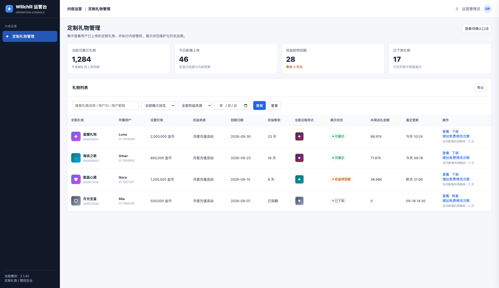

列表支持搜索、筛选、查询、重置和导出。权益来源筛选及列表数据只使用一个枚举值：`月度充值活动`；后台不新增其他权益来源选项。

| 筛选/字段 | 原型可见内容 | 需求口径 |
|---|---|---|
| 搜索 | 礼物名称、用户ID、用户昵称 | 在当前后台列表范围内检索；匹配规则和分页未定义 |
| 展示状态 | 全部展示状态、可展示、已下架、权益到期 | 成功提交后为可展示；权益到期后客户端隐藏；后续新权益成功发放后，因权益到期而隐藏的礼物自动恢复为可展示并可赠送；后台下架/恢复成功后客户端立即生效 |
| 权益来源 | 全部权益来源、月度充值活动 | 本后台字段/筛选的唯一业务枚举为月度充值活动 |
| 日期筛选 | 日期输入框 | 原型未明确该日期对应到期日期、更新时间或其他日期，字段语义待确认 |
| 查询/重置/导出 | 查询、重置、导出 | 查询与重置作用于当前筛选条件；导出范围和字段是否与列表一致待确认 |
| 定制礼物 | 礼物名称及纯数字编号 | 编号按纯数字展示；示例 `240918001`、`240918002`、`240917018`、`240912042` 仅为样例格式 |
| 所属用户 | 用户昵称及用户ID | 展示当前礼物所属用户，不等同于送礼对象或榜一送礼用户 |
| 设置价格 | 金币价格 | 展示当前礼物设置价格；价格锁定和变更规则沿用4.4—4.6、5.2 |
| 到期日期 | `YYYY-MM-DD`日期 | 与“权益剩余”并列展示具体到期日期；日期来源、时区和到期后的处理见U03 |
| 权益剩余 | 剩余天数或已到期 | 用于运营快速判断权益状态；取整口径见U03 |
| 当前边框样式 | 图片缩略预览 | 列表展示所属用户按5.6实时匹配的当前边框；存量礼物升降档后同步更新 |
| 展示状态 | 可展示、权益将到期、已下架等标签 | 成功提交无需审核并立即可展示；权益到期时客户端隐藏；后续新权益成功发放后自动恢复可展示并可赠送；后台操作成功后立即切换客户端展示状态 |
| 本周送礼金额 | 定制礼物本周送礼金额 | 沿用5.4礼物送礼金额口径，不包含修改费用 |
| 最近更新 | 最近一次更新日期/时间 | 更新事件范围及失败提交是否更新见U06/U08 |
| 操作 | 查看、下架；已下架记录可恢复；增加免费修改次数 | 下架/恢复的触发权限、客户端可见性、历史统计影响见U07/U08；原型未提供详情内管理操作 |

#### 5.7.3 定制礼物详情与操作边界

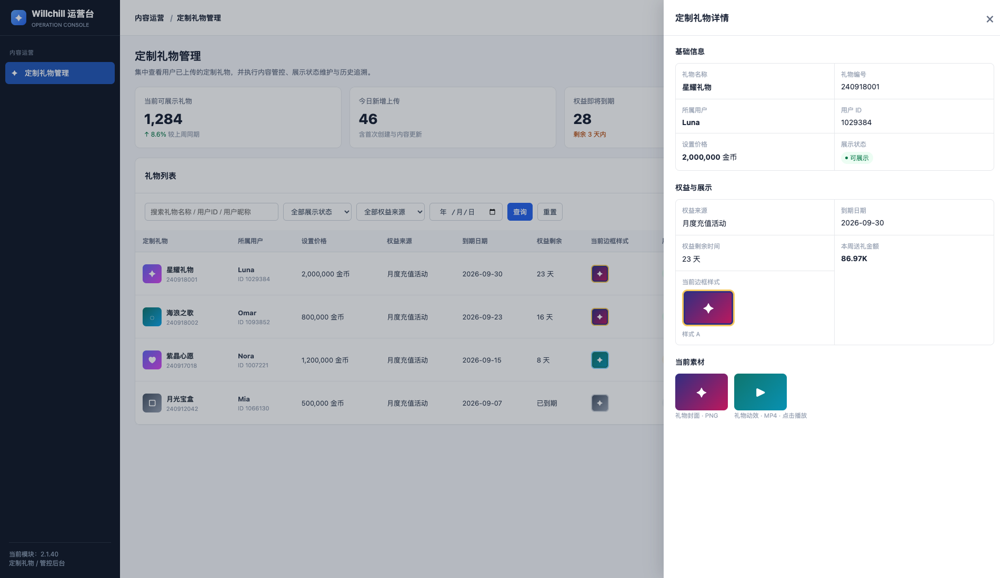

点击列表“查看”打开详情抽屉。详情展示当前礼物的识别信息、所属用户、价格、权益来源、到期日期、剩余天数、当前边框样式图片、展示状态及本周送礼金额；点击礼物动效预览可播放当前礼物动效。

详情页规则如下：

- 当前边框样式必须以图片预览展示，不用纯文字标签替代。
- 详情不展示“变更记录”“管理操作”“查看完整变更记录”。
- 详情抽屉用于查看，不新增独立编辑、审核或价格修改入口。
- 详情中的到期日期与权益剩余同时保留，不能用剩余天数替代具体日期。
- 点击“礼物动效”预览区播放当前礼物动效；播放中再次点击暂停。该动作只用于查看当前素材，不新增编辑、替换、下载或审核入口。

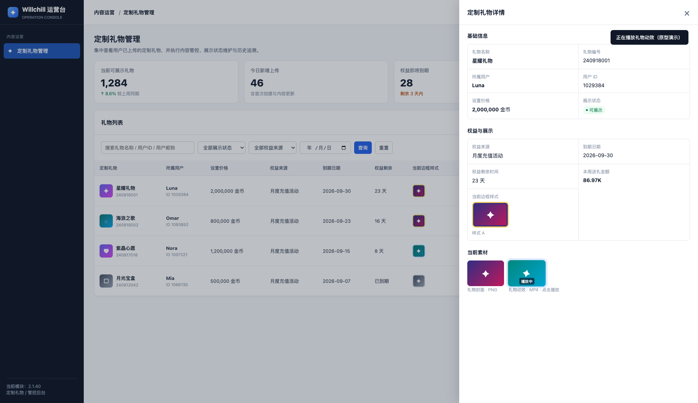

*图：详情抽屉中点击礼物动效后的播放状态；“播放中”表示礼物动效正在预览，不代表素材审核状态或礼物展示状态。*

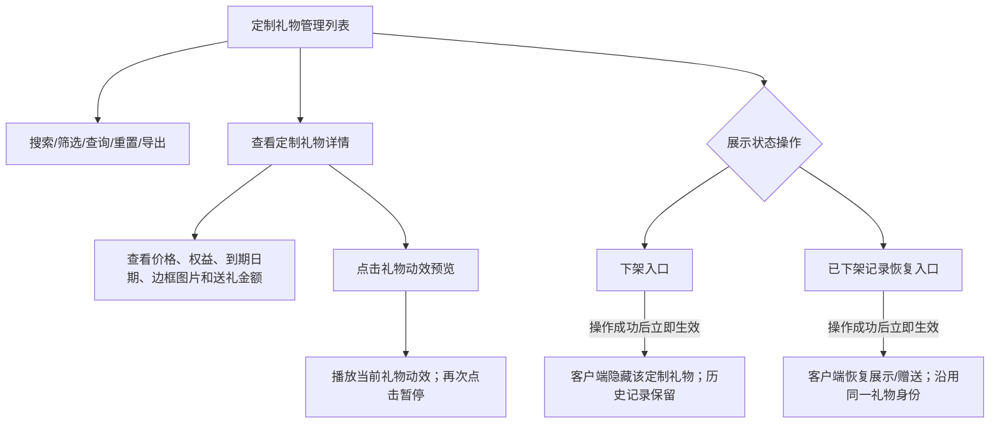

定制礼物提交和内容修改无需素材审核；成功提交或修改后客户端立即生效。后台下架/恢复操作成功后也立即改变客户端展示状态。仍待确认：后台操作角色与数据权限、下架/恢复是否需要理由或二次确认、操作审计、恢复条件、列表分页与导出范围，以及后台下架对历史榜单和送礼统计的影响。

#### 5.7.4 增加当月免费修改次数

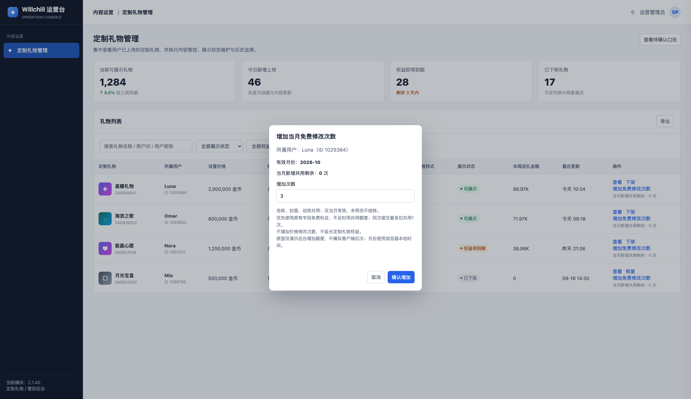

入口位于定制礼物列表操作列，名称为“增加免费修改次数”；点击后打开增加次数弹窗，不新增独立后台模块，不在详情中恢复“管理操作”区域。

| 字段/操作 | 展示与规则 |
|---|---|
| 所属用户 | 展示当前行礼物所属用户昵称和用户ID，增加对象为该用户，不可误记到其他用户 |
| 有效月份 | 展示本次增加操作所属当月；仅该月有效，未使用次数不结转下月 |
| 名称剩余次数 | 展示该用户当月礼物名称剩余免费修改次数 |
| 封面剩余次数 | 展示该用户当月礼物封面剩余免费修改次数 |
| 动效剩余次数 | 展示该用户当月礼物动效剩余免费修改次数 |
| 增加次数 | 输入大于0的整数N；空值、0、负数及小数不可确认，提示“请输入大于0的整数次数”；业务上限待确认 |
| 取消 | 关闭弹窗，不增加任何字段次数 |
| 确认增加 | 成功后，名称、封面、动效三个字段分别增加N次当月免费修改次数；再次增加时分别累加，不覆盖现有剩余次数 |

后台输入N后，名称、封面、动效三个字段分别增加N次，不设置共用次数池。用户后续实际修改哪个字段，仅消耗该字段自身1次；同次修改多个字段时，每个实际变化字段分别消耗自身1次。不增加价格修改次数，不延长权益。增加次数不代表礼物恢复展示或重新获得定制礼物权益。

操作失败不得显示增加成功；结果未知、重复请求不得被直接当作新的增加操作。跨月时不能把原月份弹窗中的次数静默加到另一月份，应重新确认目标月份。后台角色与授权、增加次数业务上限、结果未知后的核实及幂等判定见U07/U13；客户端各字段次数的扣减与失败恢复见U06/U13。

当前HTML演示增加、累加、取消、输入校验及按用户/月隔离；使用浏览器本地月份和内存数据，不代表正式业务时区、真实发放或客户端扣次规则。

客户端进入上传页时的下架提示按4.4.5执行；仅后台下架且权益仍有效时显示，不把权益到期隐藏混作后台下架。

### 5.8 提交一致性、失败与重复操作

本节列出待确认的提交一致性、失败处理及重复操作规则，不定义退款或补偿方案。

| 关键场景 | 需要得到唯一答案 | 关联待确认项 |
|---|---|---|
| 非价格信息付费确认弹窗 | 只表示同意，还是此刻即扣钱/扣次数 | U06 |
| 内容提交成功 | 提交内容、有效内容和费用是否同时完成 | U06、U07 |
| 余额不足/扣款失败 | 是否停止修改，如何提示，是否消耗次数 | U06 |
| 已扣款但内容失败 | 退款、待重试还是其他处理；何时恢复次数 | U06 |
| 免费修改失败 | 免费次数是否已用、是否恢复以及恢复时点 | U06 |
| 重复点击/重试 | 同一次业务修改如何识别，如何避免重复付费和计次 | U06 |
| 多端同时修改 | 哪个提交有效，次数、价格和费用如何统一 | U06 |
| 权益到期或跨月 | 使用进入表单还是提交结果时的权益与周期 | U03、U06、U08 |
| 提交结果未知 | 用户重进看到什么，如何获知实际结果 | U06、U12 |

**后台增加次数：** 增加次数与用户实际修改扣次是两个独立操作；增加失败、结果未知或重复提交不得让名称、封面、动效误增多份次数。免费修改失败、并发扣次及恢复处理须分别覆盖三个字段；具体事务规则仍见U06/U13。

## 6. 待确认决策表

下表记录各事项的确认方案和当前状态。`部分落实`表示已确认部分已纳入正文，剩余边界仍待确认；`本次不处理`表示本期不补充该规则，不代表规则已经确认。

| 编号 | 待确认主题 | 必须明确的问题 | 影响模块 | 确认方案 | 确认状态与剩余边界 |
|---|---|---|---|---|---|
| U01 | Rank展示映射 | 排行主体已确认为定制礼物；大图、名称和右侧数值分别对应礼物封面、礼物名称及对应周期赠送金币总金额；小圆头像与名称已确认为对应周期内赠送该礼物金额最高的榜一用户。仍需确认Banner进入是否依赖已选礼物及排名数量范围 | 2.3、4.2 | 小圆圈头像为本周、上周赠送该礼物榜一用户的头像以及名称 | **部分确认**：已确认头像和名称映射；Banner是否依赖已选礼物、排名数量范围仍待确认 |
| U02 | 权益来源、数量与归属 | 脑图2000美元条件与首充30天规则的关系；月充x数值和币种；有效充值来源、汇率及退款影响；多来源能否叠加；一份权益对应多少礼物；公会权益归属、名额及身份/等级变化；发放、重复达标和到账处理 | 2.1、2.2、4.3、5.1 | 来源只有当前的月充活动逻辑，去掉首冲和荣誉公会活动 | **部分确认**：已确认权益仅来源于月度充值活动，门槛为US$2,000，每次增加30天且每自然月最多1次；单份权益可关联的礼物数量、发放失败、补发幂等及退款处理仍待确认 |
| U03 | 权益生命周期 | 有效天数、剩余天数取整；获得即计时原节点中的“定制头像”是否笔误；到期后的入口、编辑与赠送状态；编辑中到期如何处理；次月重新获得是续期还是新权益；未使用权益是否保留 | 2.4、3.2、4.3—4.6、5.1 | 定制头像为笔误；到期后定制礼物栏不再展示用户的定制礼物，原礼物信息继续保留；入口变更为未获得定制礼物状态；后续重新获得的是新权益，成功发放后原礼物自动恢复展示并可赠送。 | **部分确认**：已确认统一术语、到期隐藏、原礼物信息保留、入口状态、新权益记录及成功发放后的自动恢复展示与赠送；剩余天数取整、到期精确时点、编辑中到期及草稿处理仍待确认 |
| U04 | 定价与锁价 | 最低金币价、输入格式与范围；首次设置是否占月内1次；每月首次改价确认；锁定周期；后续自然月改价资格与旧价关系 | 3.3、4.4—4.6、5.2 | 最低价格暂定200000金币；首次设置占用创建当月机会；后续每个自然月在权益有效时可修改1次价格；提交变化价格时先提示“设置后本月将无法更改”，确认且新价格成功后当月锁定 | **部分确认**：已确认每月1次价格设置/修改机会、确认弹窗、成功后锁定、取消不消耗、后续自然月不要求重新获得新权益；最高价、输入格式、弹窗并发顺序及U06事务时点仍待确认 |
| U05 | 修改次数与定价 | 每月修改次数是否按字段独立；名称如何计次；首次上传、无变化提交算不算；第二次及以后300000金币费用；同一提交多个超额字段如何收费 | 3.3、4.6、5.3 | 名称、封面、动效分别拥有独立修改次数；首次上传分别计次，无变化不计；任一变化字段无可用次数时，本次提交固定收取300000金币；同次多个超额字段只收一次 | **已确认**：三个非价格字段独立计次、独立消耗，付费修改次数不限；价格不参与该次数体系；后台增加次数时三个字段分别增加相同次数 |
| U06 | 扣款、次数与提交结果 | 何时扣钱、锁价、消耗次数；余额不足、上传失败、扣款成功但修改失败怎么处理；重复点击、结果未知、多端修改的同一业务结果判定；取消及重试后费用/额度如何处理 | 3.2、3.3、4.5、4.6、5.8 |  | **待确认**：人工方案为空，正文不补默认事务规则 |
| U07 | 生效及后台范围 | 提交后何时可赠送；是否审核；修改期间使用旧内容还是新内容；后台具体功能、角色与操作权限；下架/恢复是否需要理由与审计；操作后的客户端生效时点；本次后台HTML已作为页面结构与字段事实来源，但不替代正式权限和生效规则 | 2.4、3.2、4.1、4.5、4.6、5.7 | 提交后即可在礼物栏展示可赠送，无需审核；修改期间使用就内容；操作后的客户端立即生效。 | **部分确认**：修改期间继续使用旧内容，成功提交、修改及后台操作后立即生效；已确认权益未过期且后台下架时每次进入上传页提示；重新上传后与后台恢复的关系、后台角色、权限、操作理由和审计规则仍待确认 |
| U08 | 周期与历史 | 时区、周/月起止；Refresh的含义；上周榜是否冻结；礼物栏与Rank本周榜排序；改名改图改价、续期和到期后是否延续同一礼物及历史图文；周期边界与撤销统计 | 2.3、4.1、4.2、5.4 | 时区按UTC+3自然周；礼物栏与Rank本周榜仅按本周榜单积分降序，不使用上传者本月充值金额、首次上传时间或先达到积分时间参与排序；上周榜直接展示周结束时冻结的排名与积分；改名改图改价、续期和到期后延续同一礼物及历史图文 | **部分确认**：已确认周口径、本周榜仅按积分排序、上周冻结规则及礼物身份延续；Refresh含义及历史榜图文展示当前或周期内容仍待确认 |
| U09 | 赠送成功与金币统计 | 是否完全沿用已有普通送礼规则；对象、数量、送礼与收礼资格；扣费与收礼结果；统计成功时点、价格与数量口径；失败、重复和撤销是否扣回排名贡献 | 3.2、4.1、5.4 | 完全沿用已有普通送礼规则； | **部分确认**：赠送流程沿用系统现有普通礼物规则；具体适用规则文档及版本仍待确认 |
| U10 | 边框主体、月口径与档位 | 本月与上月分别按什么主体统计活动有效充值金额；充值活动PRD已明确的有效金币来源、允许计入行为、计入系数、88,888金币兑US$1及UTC+3自然月周期直接沿用；两个月取最高值后的档位、未达档默认样式、月切换、升降档生效和存量礼物展示 | 4.1、5.4、5.6 | 主体为定制礼物所属用户；低于US$2,000显示基础默认样式，达到US$2,000显示普通档，达到US$3,000显示高级档；金额变化后实时升降档；月切时按新的本月/上月最高值重新匹配；全部存量礼物同步更新 | **已确认**：金额主体、公式、三段档位、边界包含关系、实时升降档、月切重算和存量展示均已明确；金额定义沿用充值活动PRD |
| U11 | 表单与素材校验 | 30字计数和名称合法性；必填项、格式校验及提示；1920×1080、8S是固定值还是上限；配置获取异常；素材查看/播放控件及失败处理 | 4.4—4.6、5.5 | 封面图片与动效文件的体积上限由服务端配置，默认分别为1MB、10MB；已选或已上传图片支持点击查看，MP4支持点击播放；点击下方“更换”分别拉起图片或视频选择器，选中新素材后更新表单预览 | **部分确认**：素材体积配置、查看/播放入口和更换选择器已确认；分辨率、时长、格式校验、查看/播放形态、配置异常和素材失败处理仍待确认 |
| U12 | 页面返回与提示 | 各页返回与问号落点；Go目标页；获取方式为页面还是弹层；空态、无榜一及失败提示；草稿与取消后内容保留；不再提示的范围；提交结果反馈；重新进入Rank是否重置为本周；原型月充英文错拼的正式文案；是否另出阿语用户文案 | 4.1—4.6、6.1 | 无需处理 | **本次不处理**：不等于已确认，正文不新增页面返回与提示规则 |

| U13 | 后台增加各字段当月免费修改次数 | 三个字段剩余次数的展示位置；同一用户多礼物适用范围；自然月时区、跨月归属；增加上限、权限与重复/未知结果处理 | 2.2、3.3、4.4—4.6、5.3.2、5.4、5.7.4、5.8 | 名称、封面、动效字段下分别展示服务端返回的本字段剩余次数；后台输入N后，三个字段分别增加N次，不设置共用池 | **部分确认**：已确认字段独立展示、增加对象、字段范围、增加单位和独立扣次；不增加价格修改机会、不延长权益；多礼物范围、时区、上限、权限、实际扣次与失败恢复仍待确认 |

### 6.1 原始需求材料的采用边界

脑图“原始需求材料”中还包含“高级用户1个月内更换3次礼物样式”“付费获得更换权益”“一个月内不可更改价格”以及“翻译为阿语”等描述。

- “高级用户1个月内更换3次”已由“非价格礼物信息可不限次数付费修改”规则替代，不再作为次数上限；第二次及第三次以后每次付费提交均收取300000金币，同次提交多个超额字段只收一次。
- 自行上传动画、命名和定价已落实到4.4—4.6。
- 最低价格暂定为200000金币；每个自然月只有1次价格设置/修改机会，成功后当月锁定，月内无法二次改价。
- 本期仅交付中文PRD，不包含App端语言切换、礼物名称自动翻译或阿语输入限制；是否另行提供阿语用户文案见U12。

- 后台增加当月免费修改次数时，输入N将使名称、封面、动效三个字段分别增加N次，见5.3.2、5.7.4；三个字段始终独立计次，不设置共用次数。

## 7. 材料对照与评审状态

### 7.1 原型与正文对照

| 原型文件 | 对应章节 | 承接内容 |
|---|---|---|
| 定制礼物全交互流程.jpg | 3.1—3.3 | 整体入口与页面关系、并列弹窗与未确认衔接 |
| 定制礼物栏.jpg | 4.1 | 分类、Banner、榜一头像、礼物列表与赠送入口 |
| 定制礼物排行榜.jpg | 4.2 | Rank/Upload、本周/上周、列表构成与Refresh |
| 定制礼物上传_未获得权益.jpg | 4.3 | 权益卡、问号、How to get；原型中的三种获取方式仅作页面证据，当前业务只保留月度充值活动，首充与荣誉公会已移除 |
| 上传定制礼物_空状态.jpg | 4.4 | 字段占位、规格、价格限制、上传及剩余天数 |
| 上传定制礼物_已填写未提交.jpg | 4.5 | 填写内容、素材缩略图和提交边界 |
| 上传定制礼物_已填写本月已提交.jpg | 4.6 | 已有内容、非价格信息第二次付费，以及每月首次修改价格时的锁价确认弹窗 |
| 后台原型/定制礼物管理后台.html | 5.7 | 定制礼物管理列表、详情、筛选、导出及展示状态操作 |
| 2.1.40原型图/定制礼物管理后台-定制礼物管理.png | 5.7.2 | 定制礼物管理列表完整导出图 |
| 2.1.40原型图/定制礼物管理后台-定制礼物详情.png | 5.7.3 | 定制礼物详情抽屉完整导出图 |
| 2.1.40原型图/定制礼物管理后台-礼物动效播放.png | 5.7.3 | 定制礼物详情内点击动效后的播放状态导出图 |
| 2.1.40原型图/定制礼物管理后台-增加当月免费修改次数.png | 5.7.4 | 增加次数弹窗；输入次数同时增加至名称、封面、动效三个独立字段 |

本次客户端上传表单更新对照：空状态与已填写未提交状态已在名称、封面、动效字段下分别展示“本月剩余1次免费修改”，空状态不再展示底部统一次数。需求按已确认的字段独立计次规则统一要求4.4—4.6均采用字段下独立展示，并移除底部统一次数。已填写未提交、已填写本月已提交原型仍保留底部统一次数，且已提交原型缺少名称字段次数，属于原型未同步项；不得据此恢复共用次数。原型中的封面10MB/100MB和动效100MB已由正式配置规则替代：封面图片默认1MB、动效文件默认10MB，均由服务端配置并返回，客户端不得写死。原型示例1次、23天等不作为客户端固定值。

### 7.2 业务建模稿规则采用说明

| 规则项 | 本PRD采用口径 |
|---|---|
| 提交后的展示与赠送 | 成功提交后无需审核，立即展示并可赠送；处理中继续使用旧内容 |
| Rank排行口径 | 按所选周期内各定制礼物的成功赠送金币总金额降序排名；礼物栏排序、榜一头像与Rank页面分别定义，未确认的附属展示映射见U01 |
| 付费确认弹窗 | 用户确认仅表示付费修改意愿；扣款、次数消耗、锁价及生效时点见U06 |
| 权益与礼物关系 | 次月达标形成新的权益发放记录，并继续关联同一定制礼物身份；单份权益可关联的礼物数量见U02 |
| 非价格信息修改次数与费用 | 名称、封面、动效按字段独立计次；第二次及第三次以后每次付费提交固定收取300000金币，付费次数不限，同次提交多个超额字段只收一次 |
| 每月价格修改确认弹窗 | 当月价格机会未使用且价格发生变化时展示，提醒新价格成功后本月不能再次修改；当月机会已使用后再次改价直接阻止 |
| 素材规格 | 封面图片体积上限由服务端配置、默认1MB；动效文件体积上限由服务端配置、默认10MB；客户端使用服务端当前值展示和校验，不得写死；分辨率、时长及格式校验边界仍见U11 |
| 后台定制礼物管理 | 第5.7节依据后台“定制礼物管理”HTML及列表、详情导出图定义字段与操作边界；权限、生效和历史影响见U07、U08 |

后台输入的增加次数同时加到名称、封面、动效三个字段，各字段独立记录和消耗，不存在共用额度。具体规则以5.3.2、5.7.4为准，剩余展示及操作边界见U13。

### 7.3 文档状态

当前已确认权益来源、30天有效期、到期隐藏、提交生效、字段独立修改、价格锁定、素材体积服务端配置默认值、UTC+3自然周榜单、普通礼物赠送及边框规则。U06事务与幂等、U11剩余校验边界和U12仍待确认，**因此本文仍为评审稿，暂不作为研发冻结版本。**

后续规则确认后，对象口径、相关页面、共用规则、流程分支和待确认表应同步更新，并清除流程图中的旧口径。
